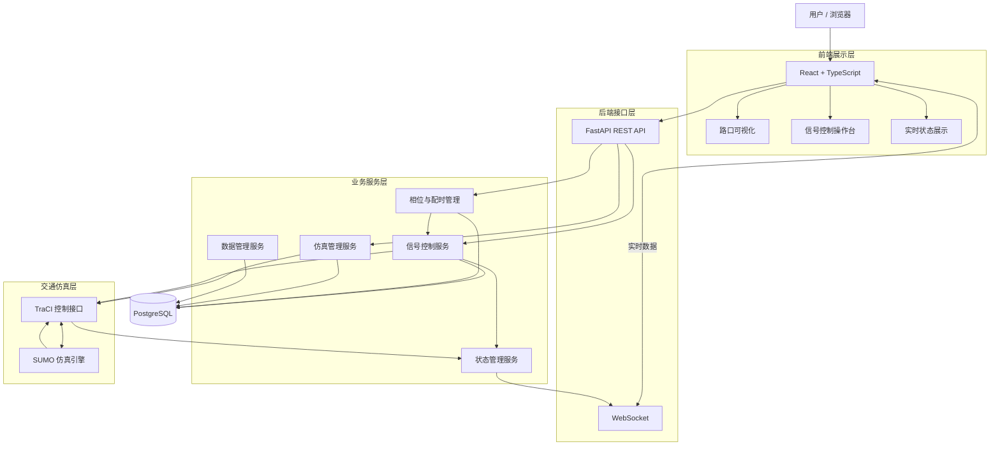
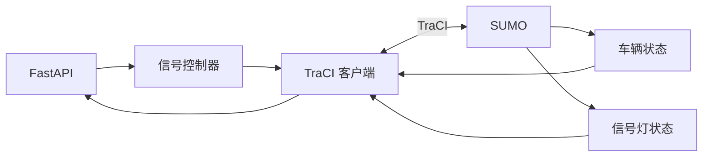
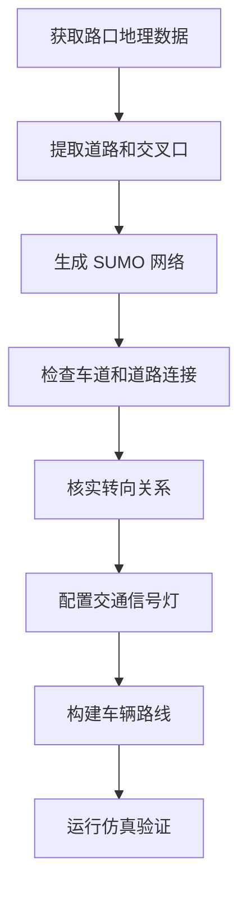
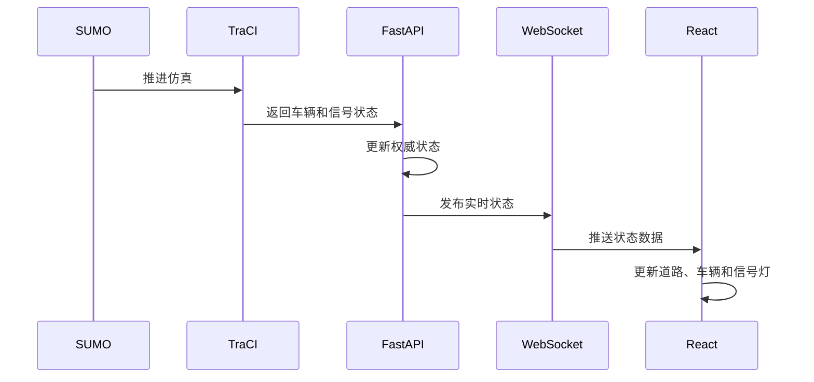
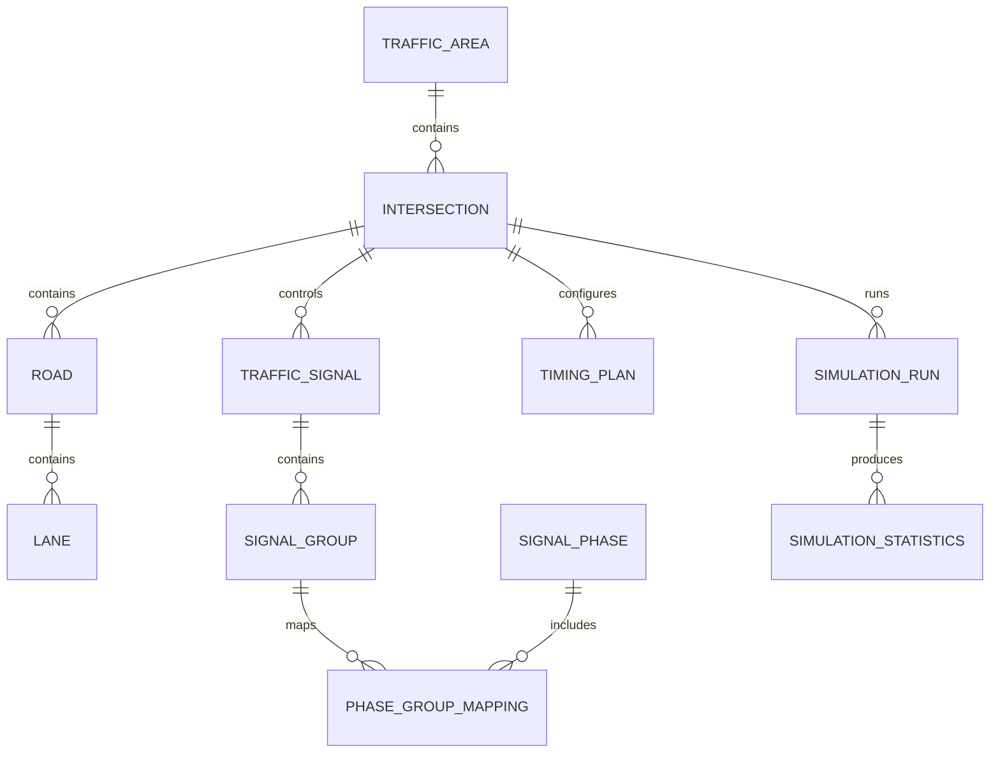
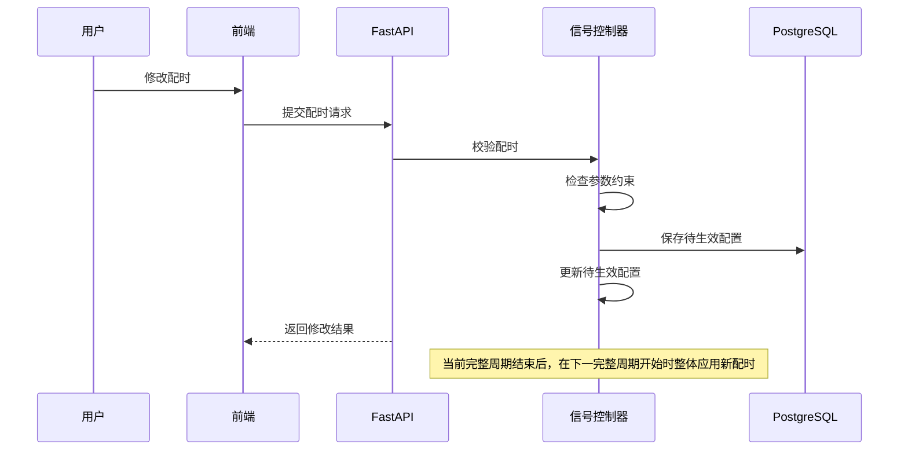
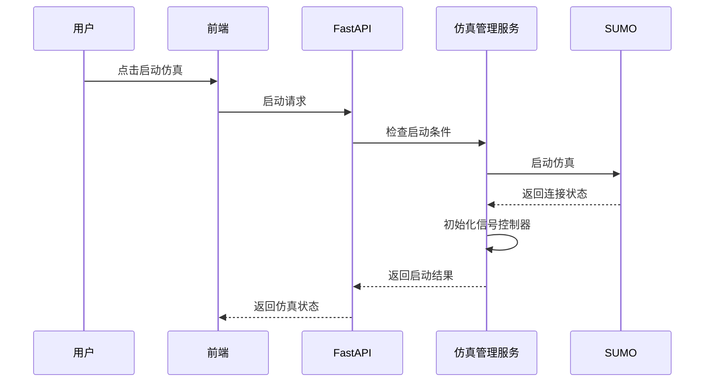
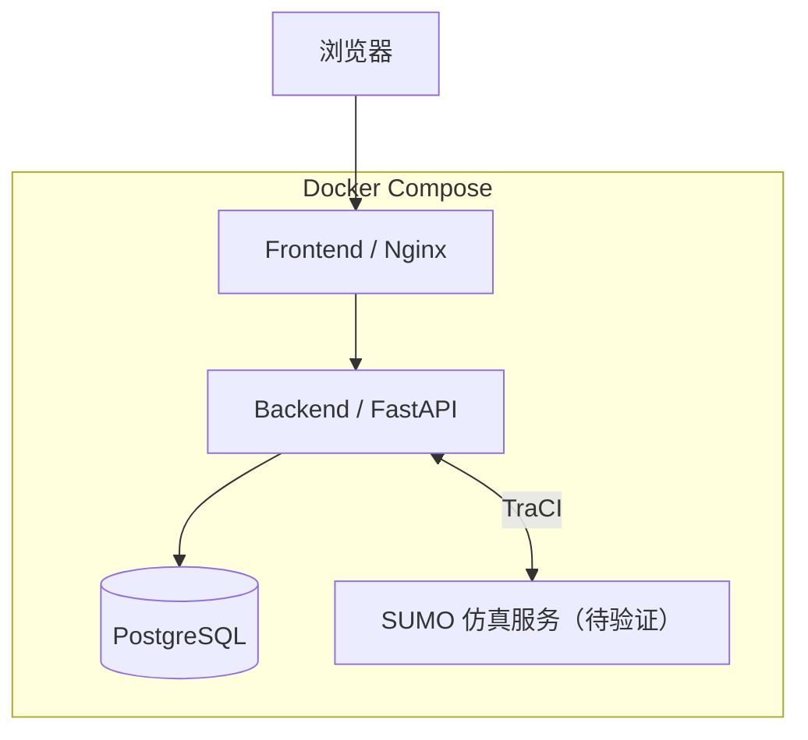
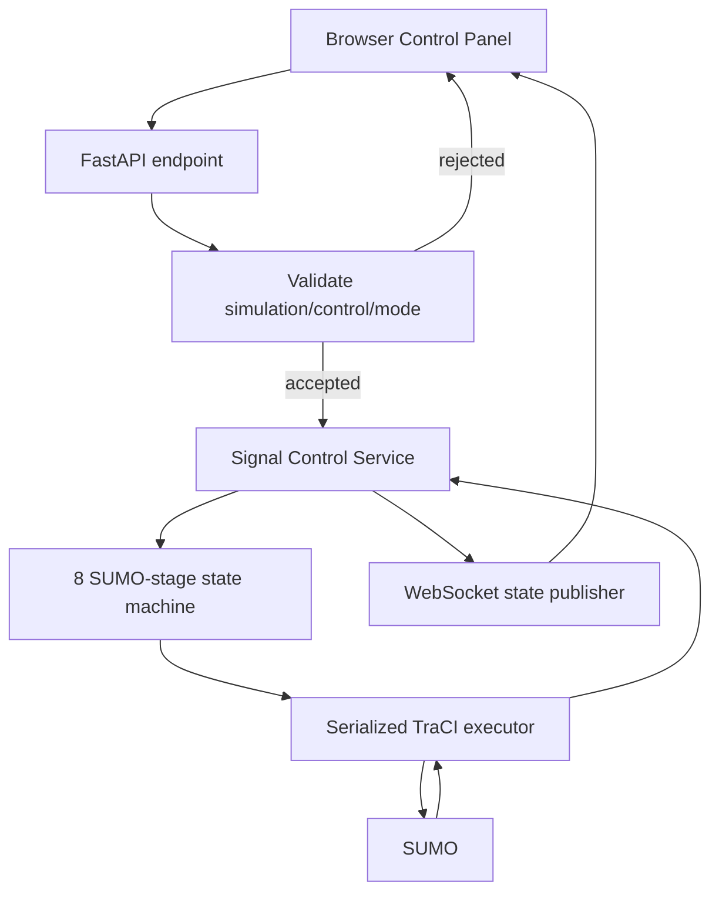

# 系统架构设计

> 文档版本：V1.0
> 创建日期：2026-11-10
> 项目名称：交通信号控制平台
> 文档状态：初稿
> 对应需求文档：`docs/01-requirements.md`

## 1. 架构设计目标

本项目采用前后端分离架构，结合 SUMO 交通仿真引擎，实现单路口交通信号控制、车辆运行仿真、信号状态实时展示和运行数据持久化。

架构设计需要满足以下目标：

1. **信号控制可靠**：信号灯状态、相位切换和倒计时由后端统一管理。
2. **交通仿真真实**：使用 SUMO 模拟车辆运行、车道连接、交通信号灯和车辆通行行为。
3. **实时数据同步**：通过 WebSocket 向浏览器推送车辆位置和信号状态。
4. **配时灵活配置**：分别配置南北直行、南北左转、东西直行、东西左转四类受保护信号组的绿灯和黄灯，并按完整周期计算红灯持续时间。
5. **状态一致性**：后端控制状态与 SUMO 仿真状态保持一致。
6. **模块职责清晰**：前端、后端、信号控制器、仿真引擎和数据库相互解耦。
7. **便于扩展**：为多路口协调控制、自适应信号控制和更精细的交通参与者仿真预留接口。

## 2. 总体技术架构

### 2.1 技术选型

| 系统模块   | 技术                         | 主要用途                         |
| ---------- | ---------------------------- | -------------------------------- |
| 前端框架   | React                        | 页面和交互界面                   |
| 前端语言   | TypeScript                   | 类型安全                         |
| 前端构建   | Vite                         | 开发和构建                       |
| 二维可视化 | SVG                          | 二维路口、车道、车辆和信号灯展示 |
| 三维可视化 | Three.js + React Three Fiber | 三维道路、车辆和交通设施场景     |
| 后端框架   | Python + FastAPI             | REST API 和业务服务              |
| 数据校验   | Pydantic                     | 请求、响应和配置校验             |
| 实时通信   | WebSocket                    | 推送仿真状态                     |
| 交通仿真   | SUMO                         | 道路网络和车辆运行仿真           |
| 仿真控制   | TraCI                        | 控制 SUMO、读取仿真状态          |
| 数据库     | PostgreSQL                   | 配时、运行记录和历史数据         |
| 数据访问   | SQLAlchemy                   | 数据库 ORM                       |
| 数据迁移   | Alembic                      | 数据库结构版本管理               |
| 容器部署   | Docker Compose               | 服务部署和管理                   |
| 版本管理   | Git + GitHub                 | 代码和文档版本管理               |

### 2.2 系统分层

系统划分为五个主要层次：

1. 展示层：浏览器中的交通信号控制操作台。
2. 接口层：FastAPI 提供 REST API 和 WebSocket。
3. 业务层：负责信号控制、配时管理、仿真管理和数据管理。
4. 仿真层：SUMO 和 TraCI。
5. 数据层：PostgreSQL。

### 2.3 系统总体结构



说明：

- REST API 负责配置修改、仿真启动、暂停、恢复和查询。
- WebSocket 负责实时状态推送。
- 信号控制服务负责统一管理信号机状态。
- TraCI 负责将后端控制指令传递给 SUMO。
- SUMO 负责车辆运动和交通规则仿真。
- PostgreSQL 保存需要长期保留的业务数据和仿真记录。

## 3. 前端架构

### 3.1 前端职责

前端主要负责：

1. 展示交通路口的道路和车道。
2. 展示各方向交通信号灯。
3. 展示信号机当前相位和倒计时。
4. 实时展示机动车位置和行驶状态。
5. 提供信号灯配时设置。
6. 提供仿真启动、暂停、恢复和停止操作。
7. 展示仿真运行统计信息。
8. 展示信号灯历史状态和仿真记录。

前端不直接控制 SUMO，也不负责计算信号灯下一次切换时间。

### 3.2 前端组件划分

建议采用以下组件结构：

```
frontend/
└── src/
    ├── api/
    │   ├── http.ts
    │   ├── signal.ts
    │   ├── simulation.ts
    │   └── intersection.ts
    │
    ├── components/
    │   ├── intersection/
    │   │   ├── IntersectionView.tsx
    │   │   ├── Road.tsx
    │   │   ├── Lane.tsx
    │   │   ├── Vehicle.tsx
    │   │   └── TrafficLight.tsx
    │   │
    │   ├── signal/
    │   │   ├── SignalPanel.tsx
    │   │   ├── PhaseDisplay.tsx
    │   │   └── TimingConfig.tsx
    │   │
    │   └── simulation/
    │       ├── SimulationToolbar.tsx
    │       └── SimulationStatus.tsx
    │
    ├── hooks/
    │   ├── useWebSocket.ts
    │   └── useSimulation.ts
    │
    ├── types/
    │   ├── signal.ts
    │   ├── vehicle.ts
    │   └── simulation.ts
    │
    ├── pages/
    │   └── Dashboard.tsx
    │
    └── App.tsx
```

以上为建议目录结构，实际开发时根据模块实现情况逐步建立，不要求一次性创建所有文件。

### 3.3 路口可视化

前端保留二维 SVG 路口视图，并新增基于 Three.js 的三维场景；建议使用 React Three Fiber 管理 Three.js 场景与 React 组件生命周期。

- **二维视图：** 使用 SVG 展示道路、车道、停止线、车辆和信号灯，保留现有二维实现。
- **三维视图：** 使用 Three.js（建议 React Three Fiber）展示道路、车道、车辆、信号灯及交通设施。
- **统一数据：** 二维和三维视图订阅同一份规范化仿真状态与静态路网数据，不各自维护车辆或信号灯状态。
- **坐标转换：** 统一使用 SUMO 坐标到前端世界坐标的转换关系，避免两个渲染器分别硬编码偏移。
- **视图切换：** 切换只改变当前渲染器，不重启仿真、不重建 WebSocket 连接，也不改变信号控制状态。

车辆位置以 SUMO 返回的位置为准，前端只负责坐标转换和显示。三维模型和相关依赖属于目标架构，是否已安装或实现以实际代码为准。

## 4. 后端架构

### 4.1 后端职责

后端是整个系统的业务控制中心。

主要职责：

1. 接收前端控制请求。
2. 校验信号灯配时参数。
3. 管理信号机运行状态。
4. 管理信号相位切换。
5. 控制 SUMO 仿真。
6. 读取车辆和信号灯状态。
7. 推送实时仿真数据。
8. 保存仿真运行记录。
9. 提供历史数据查询接口。

### 4.2 后端模块划分

```
backend/
├── app/
│   ├── api/
│   │   ├── routes/
│   │   │   ├── signal.py
│   │   │   ├── simulation.py
│   │   │   └── intersection.py
│   │   │
│   │   └── websocket.py
│   │
│   ├── controllers/
│   │   └── signal_controller.py
│   │
│   ├── core/
│   │   ├── config.py
│   │   ├── exceptions.py
│   │   └── logging.py
│   │
│   ├── models/
│   │   ├── signal.py
│   │   ├── simulation.py
│   │   └── vehicle.py
│   │
│   ├── repositories/
│   │   ├── signal_repository.py
│   │   └── simulation_repository.py
│   │
│   ├── services/
│   │   ├── signal_service.py
│   │   ├── timing_service.py
│   │   ├── simulation_service.py
│   │   └── state_service.py
│   │
│   └── simulation/
│       ├── traci_client.py
│       ├── simulation_runner.py
│       └── vehicle_collector.py
│
└── tests/
```

模块职责：

| 模块         | 主要职责           |
| ------------ | ------------------ |
| api          | 接收请求和返回响应 |
| controllers  | 实现信号控制状态机 |
| core         | 配置、异常和日志   |
| models       | 数据结构和业务模型 |
| repositories | 数据库读写         |
| services     | 业务逻辑           |
| simulation   | SUMO 和 TraCI 集成 |
| tests        | 自动化测试         |

模块之间通过明确的接口调用，避免直接访问其他模块的内部状态。

## 5. 交通信号控制架构

### 5.1 信号控制基本原则

信号控制器由后端统一维护。

以下信息由后端作为权威状态保存：

- 当前信号阶段。
- 当前相位。
- 当前阶段开始时间。
- 当前阶段计划结束时间。
- 当前剩余时间。
- 当前信号灯颜色。
- 下一阶段。
- 当前生效的配时参数。

SUMO 中的交通信号状态必须与后端信号控制器保持一致。

前端只接收后端推送的数据，不自行维护另一套信号切换逻辑。

### 5.2 第一版信号相位与信号组

第一版包含四类受保护业务通行阶段：

| 顺序 | 业务阶段 | 同时放行的方向 | 受保护信号组  | 同方向另一类主交通流 |
| ---: | -------- | -------------- | ------------- | -------------------- |
|    1 | 南北左转 | 北向、南向左转 | `NS_LEFT`     | `NS_STRAIGHT` 为红   |
|    2 | 南北直行 | 北向、南向直行 | `NS_STRAIGHT` | `NS_LEFT` 为红       |
|    3 | 东西左转 | 东向、西向左转 | `EW_LEFT`     | `EW_STRAIGHT` 为红   |
|    4 | 东西直行 | 东向、西向直行 | `EW_STRAIGHT` | `EW_LEFT` 为红       |

南北两个相反方向的左转同时放行；东西两个相反方向的左转同时放行。该放行关系是用户确认的交通组织要求，但仍须通过目标 SUMO 网络的连接关系和冲突矩阵验证。

四个进口方向分别设置独立左转、直行、右转车道。左转、直行不得共用车道；右转也不得与左转或直行共用车道。

右转不属于上述四类保护式阶段。四个方向的右转车辆始终采用独立让行规则，不获得优先通行权：接近冲突区域时减速观察，遇到行人、非机动车或其他冲突交通流时停车等待，冲突解除后通过。当前 SUMO TLS 程序将四个右转连接（linkIndex 0、5、10、15）在全部八个阶段设置为小写 `g`，表示让行绿灯，而不是受保护绿灯或无条件通行。实际让行行为必须依据 controlled-links、冲突矩阵和车辆轨迹验证。

### 5.3 信号阶段状态机

第一版由一个统一的后端信号控制器管理整个路口。四类业务通行阶段分别包含绿灯阶段和黄灯过渡阶段，因此 SUMO 控制程序包含 8 个绿/黄灯阶段：

| SUMO 阶段索引 | 阶段 ID              | 放行信号组       | 当前测试基线 |
| ------------: | -------------------- | ---------------- | -----------: |
|             0 | `NS_LEFT_GREEN`      | `NS_LEFT` 绿     |        20 秒 |
|             1 | `NS_LEFT_YELLOW`     | `NS_LEFT` 黄     |         3 秒 |
|             2 | `NS_STRAIGHT_GREEN`  | `NS_STRAIGHT` 绿 |        40 秒 |
|             3 | `NS_STRAIGHT_YELLOW` | `NS_STRAIGHT` 黄 |         3 秒 |
|             4 | `EW_LEFT_GREEN`      | `EW_LEFT` 绿     |        20 秒 |
|             5 | `EW_LEFT_YELLOW`     | `EW_LEFT` 黄     |         3 秒 |
|             6 | `EW_STRAIGHT_GREEN`  | `EW_STRAIGHT` 绿 |        40 秒 |
|             7 | `EW_STRAIGHT_YELLOW` | `EW_STRAIGHT` 黄 |         3 秒 |

阶段顺序为 `0→1→2→3→4→5→6→7→0`。一个完整信号周期定义为从 `NS_LEFT_GREEN` 开始，到下一次 `NS_LEFT_GREEN` 开始；新配时方案在该周期边界整体切换。表中时长是现有 SUMO 测试基线，不代表真实路口最终配时已经验收。

#### 5.3.1 信号组和灯色约束

- `NS_LEFT_GREEN`：南北左转绿灯；南北直行及东西受保护信号组为红灯。
- `NS_LEFT_YELLOW`：南北左转黄灯；其他受保护信号组为红灯。
- `NS_STRAIGHT_GREEN`：南北直行绿灯；南北左转及东西受保护信号组为红灯。
- `NS_STRAIGHT_YELLOW`：南北直行黄灯；其他受保护信号组为红灯。
- `EW_LEFT_GREEN`：东西左转绿灯；东西直行及南北受保护信号组为红灯。
- `EW_LEFT_YELLOW`：东西左转黄灯；其他受保护信号组为红灯。
- `EW_STRAIGHT_GREEN`：东西直行绿灯；东西左转及南北受保护信号组为红灯。
- `EW_STRAIGHT_YELLOW`：东西直行黄灯；其他受保护信号组为红灯。

右转连接按独立让行规则映射，不得将其错误并入同方向直行或左转保护式绿灯。

#### 5.3.2 配时模型

每类受保护信号组分别维护绿灯和黄灯时长：

- `ns_left_green` / `ns_left_yellow`
- `ns_straight_green` / `ns_straight_yellow`
- `ew_left_green` / `ew_left_yellow`
- `ew_straight_green` / `ew_straight_yellow`

每类绿灯必须大于 8 秒；每类黄灯必须大于 0 秒，默认 3 秒。四类受保护信号组的红灯总时长必须分别大于 10 秒。

在不设置额外全红阶段时，周期长度为四类信号组各自绿灯与黄灯时长之和；某一信号组的红灯时长等于周期内其他三类信号组的绿灯与黄灯时长之和。若后续冲突分析要求增加全红清空时间，则必须将该时间计入周期和红灯计算。

#### 5.3.3 配时修改与阶段边界

1. 配时方案必须先整体校验，再保存为待生效版本。
2. 运行中修改配时不得截断当前绿灯或黄灯阶段。
3. 新方案必须在约定的安全周期边界整体生效，不得在同一周期混用两个配时版本。
4. 后端状态机、SUMO 实际信号状态和 WebSocket 推送必须保持一致。
5. 手动阶段请求不得绕过或缩短黄灯阶段。

### 5.4 信号控制安全

信号控制器必须保证：

- 任意冲突的受保护交通流不会同时获得优先通行权。
- 南北左转放行时，南北直行保持红灯；东西方向受保护信号组保持红灯。
- 东西左转放行时，东西直行保持红灯；南北方向受保护信号组保持红灯。
- 南北两个相反方向的左转同时放行、东西两个相反方向的左转同时放行，是第一版已确认的交通组织要求。实际 SUMO 网络必须通过受控连接和冲突矩阵验证；若验证发现冲突，应记录设计冲突并处理，不得擅自改为单方向轮流放行。
- 右转车辆始终遵循独立让行规则，不获得优先通行权；当前 SUMO TLS 程序使用小写 `g` 表示让行绿灯。遇到行人、非机动车及其他冲突交通流时必须减速或停车让行，实际安全行为须通过车辆轨迹验证。
- 阶段顺序、绿黄红时长及倒计时符合配置。
- 仿真暂停时信号状态不继续推进；恢复时从正确阶段继续。
- 配时修改不造成当前阶段异常跳变。
- 后端状态机与 SUMO 实际信号状态一致。

所有信号组必须根据 SUMO 的 controlled links 和信号状态字符串进行映射，不能简单假设一个信号组对应一个字符。

## 6. SUMO 仿真架构

### 6.1 SUMO 的职责

SUMO 是交通运行仿真引擎，负责：

1. 道路网络加载。
2. 车道和连接关系管理。
3. 车辆生成。
4. 车辆路线规划。
5. 车辆运动和跟驰。
6. 车辆变道。
7. 交通信号灯对车辆通行行为的影响。
8. 车辆位置和运行状态输出。

后端通过 TraCI 控制 SUMO。

### 6.2 SUMO 与后端的关系



### 6.3 仿真运行流程

1. 后端检查仿真配置。
2. 后端启动 SUMO 仿真进程。
3. TraCI 建立与 SUMO 的连接。
4. 后端读取仿真初始化状态。
5. 后端信号控制器初始化相位和配时。
6. 后端向 SUMO 设置初始信号状态。
7. SUMO 开始推进仿真时间。
8. 后端读取车辆位置和信号灯状态。
9. 后端更新权威状态。
10. WebSocket 推送实时数据。
11. 仿真结束后保存运行结果。

### 6.4 仿真时间管理

仿真系统采用 SUMO 仿真时间作为运行时间基准。

后端应明确区分：

- 系统真实时间。
- SUMO 仿真时间。
- 信号阶段开始时间。
- 信号阶段计划结束时间。

信号倒计时以仿真时间为准，不直接依赖浏览器本地时钟。

仿真暂停期间，仿真时间不应继续推进。

仿真恢复后，信号阶段剩余时间应与暂停时保持一致。

### 6.5 SUMO 部署方式待验证事项

SUMO 与 FastAPI 的部署位置需要在后续技术验证阶段确定。

主要考虑两种方案：

**方案 A：SUMO 与后端部署在同一个容器**

优点：

- TraCI 本地连接简单。
- 部署结构相对简单。
- 不需要额外管理远程仿真连接。

缺点：

- 仿真进程与 API 服务耦合。
- 进程管理和故障恢复需要额外设计。
- SUMO GUI 不适合直接在普通 Linux 容器中展示。

**方案 B：SUMO 独立部署为仿真服务**

优点：

- 仿真进程与 API 服务解耦。
- 更便于后续扩展多个仿真实例。
- 可以独立管理仿真生命周期。

缺点：

- 需要管理 TraCI 远程连接。
- 需要设计服务间通信和异常恢复。
- 部署配置更复杂。

**当前设计决定：暂不锁定最终方案。**

需要先验证 Windows 开发环境、Docker Linux 容器和 SUMO/TraCI 的实际运行方式，再根据验证结果确定部署方案。

不能假定宿主机 Windows 安装的 SUMO 可以直接在 Linux Docker 容器内导入和使用 TraCI。

## 7. 道路网络与仿真场景

### 7.1 仿真地点

第一版仿真地点：

天津市河东区新开路与华龙道交叉口。

### 7.2 道路网络数据来源

优先调查 OpenStreetMap（OSM）道路数据，结合 SUMO 的 `netconvert` 工具生成仿真网络。

基本流程：



### 7.3 道路模型校验

OSM 数据不一定包含完整、准确的车道转向和信号控制信息。

因此，生成 SUMO 网络后必须检查：

- 道路数量和连接关系。
- 道路方向。
- 每个进口方向左转、直行、右转车道是否独立。
- 车道数量、宽度及车道几何。
- 车道转向属性和 SUMO lane ID。
- 路口内部连接及受控连接。
- 左转、直行、右转关系及其业务信号组映射。
- 右转连接的让行优先权及其与行人、非机动车和其他交通流的冲突对象。
- 信号灯控制连接及不同通行方向之间的冲突关系。
- 南北、东西相反方向左转同时放行是否符合实际冲突矩阵。

必要时使用 SUMO 网络编辑工具进行人工校正。车道拓扑变更后，必须重新生成 controlled-links 映射和信号状态字符串。

### 7.4 数据可信度标记

道路模型中的数据需要区分：

| 数据类型 | 说明                             |
| -------- | -------------------------------- |
| 来源数据 | 从 OSM 或其他可靠资料获取        |
| 校正数据 | 根据道路资料和网络检查修正       |
| 假设数据 | 暂时缺少可靠来源时使用的仿真参数 |

不得将未经核实的假设数据描述为真实道路测绘数据。

## 8. 实时通信架构

### 8.1 WebSocket 职责

WebSocket 用于向前端推送仿真运行状态。

主要推送内容：

- 仿真时间。
- 仿真运行状态。
- 当前信号相位。
- 各信号组灯色。
- 各信号组剩余时间。
- 车辆位置。
- 车辆速度。
- 车辆运行状态。
- 必要的仿真统计数据。

### 8.2 数据流



### 8.3 实时消息结构

第一版建议使用统一的消息结构：

```json
{
  "type": "simulation_update",
  "simulation_time": 0.0,
  "simulation_status": "RUNNING",
  "signal_control": {
    "enabled": true,
    "mode": "AUTO",
    "phase_id": "NS_LEFT",
    "phase_index": 0,
    "remaining": 20.0,
    "groups": [
      { "group_id": "NS_LEFT", "state": "G", "remaining": 20.0 },
      { "group_id": "NS_STRAIGHT", "state": "r", "remaining": 23.0 },
      { "group_id": "EW_LEFT", "state": "r", "remaining": 66.0 },
      { "group_id": "EW_STRAIGHT", "state": "r", "remaining": 109.0 }
    ],
    "right_turns": [
      { "approach": "N", "state": "PERMISSIVE_YIELD" },
      { "approach": "S", "state": "PERMISSIVE_YIELD" },
      { "approach": "E", "state": "PERMISSIVE_YIELD" },
      { "approach": "W", "state": "PERMISSIVE_YIELD" }
    ]
  },
  "vehicles": []
}
```

说明：

- 上述 JSON 为结构示例，不代表最终 API 字段已经定稿。
- `state` 需要与 SUMO 信号状态及业务灯色定义建立明确映射。
- `vehicles` 后续根据实际车辆数据结构补充。
- 前端必须以服务端推送的状态为准。

### 8.4 WebSocket 异常处理

需要考虑：

- 客户端断开连接。
- 客户端重新连接。
- 推送失败。
- 消息处理延迟。
- 重复消息。
- 前端页面刷新。

客户端重新连接后，应通过状态查询接口或 WebSocket 初始化消息获取最新完整状态，不能只依赖后续增量消息。

## 9. 数据库架构

### 9.1 数据库职责

PostgreSQL 用于保存需要持久化的业务数据。

主要包括：

- 交通路口信息。
- 道路和车道信息。
- 交通信号灯信息。
- 信号组和相位配置。
- 配时配置。
- 仿真运行记录。
- 仿真统计结果。
- 必要的信号状态历史。

车辆的高频实时位置优先保留在仿真运行时内存中，通过实时通信推送。

是否长期保存完整车辆轨迹，需要根据数据量和查询需求进一步设计，避免将高频仿真数据无差别写入数据库。

### 9.2 核心实体关系



说明：

以上为概念级实体关系，实际表结构、外键、索引和约束在 `docs/03-database-design.md` 中进一步确定。

### 9.3 数据一致性

- 数据库保存配时配置和历史记录。
- 后端内存保存当前仿真运行状态。
- SUMO 保存实际仿真中的车辆和信号状态。
- 后端负责协调以上状态的一致性。

不能将数据库中的历史状态误认为当前实时状态。

## 10. 控制请求与实时状态流程

### 10.1 修改信号配时



### 10.2 仿真启动



### 10.3 暂停和恢复

暂停时：

1. 前端发送暂停请求。
2. 后端通知仿真管理服务。
3. SUMO 停止推进仿真时间。
4. 后端保存当前信号阶段状态。
5. 前端显示暂停状态。

恢复时：

1. 前端发送恢复请求。
2. 后端检查仿真连接。
3. 恢复 SUMO 仿真推进。
4. 信号控制器继续按照仿真时间运行。
5. WebSocket 恢复实时推送。

## 11. 安全与异常处理

### 11.1 信号控制安全

以下情况必须由后端拒绝或阻止：

- 红灯时长不符合约束。
- 绿灯时长不符合约束。
- 黄灯时长小于或等于 0。
- 相位配置存在冲突。
- 仿真未启动时执行不允许的控制操作。
- 仿真已经停止时继续发送控制命令。
- SUMO 与后端状态出现无法自动恢复的不一致。

### 11.2 仿真异常

需要处理：

- SUMO 启动失败。
- TraCI 连接失败。
- SUMO 进程意外退出。
- 仿真推进异常。
- 车辆数据读取失败。
- 信号灯状态读取失败。
- 数据库连接失败。

发生关键仿真异常时，应停止继续发送不可靠的控制指令，并将系统标记为异常状态。

### 11.3 日志

日志至少记录：

- 仿真启动和停止。
- 信号相位切换。
- 配时修改。
- 信号控制命令。
- TraCI 连接状态。
- WebSocket 连接异常。
- SUMO 异常退出。
- 数据库操作异常。

重要操作应记录发生时间、操作内容、操作结果和关联仿真运行编号。

## 12. 部署架构

### 12.1 计划部署服务

Docker Compose 计划管理以下服务：

| 服务       | 作用                              |
| ---------- | --------------------------------- |
| frontend   | React 前端和 Nginx                |
| backend    | FastAPI 后端                      |
| database   | PostgreSQL                        |
| simulation | SUMO 仿真服务，是否独立部署待验证 |

### 12.2 部署关系



### 12.3 部署原则

- 服务使用明确的容器名称。
- 服务之间通过 Docker 网络通信。
- 数据库使用持久化卷。
- 配置通过环境变量或配置文件管理。
- 敏感信息不得直接提交到 Git。
- 提供统一的启动、停止和日志查看命令。
- README 中的启动命令必须经过实际验证。

最终部署方式以实际验证结果为准。

## 13. 开发实施顺序

按照以下顺序实施，避免前端、后端和仿真模块同时大规模开发。

| 阶段     | 工作内容         | 主要验收目标               |
| -------- | ---------------- | -------------------------- |
| 第一阶段 | 项目初始化与规范 | 目录、Git、基础文档        |
| 第二阶段 | SUMO 道路网络    | 路口道路和车道能够正常仿真 |
| 第三阶段 | 信号机状态机     | 红绿黄灯切换和配时规则正确 |
| 第四阶段 | FastAPI 接口     | 可以查询和控制仿真         |
| 第五阶段 | PostgreSQL       | 配时和仿真记录持久化       |
| 第六阶段 | React 可视化     | 浏览器展示路口和车辆       |
| 第七阶段 | 信控操作台       | 修改配时、控制仿真         |
| 第八阶段 | 联调与测试       | 控制、仿真、实时展示闭环   |
| 第九阶段 | Docker 部署      | 可重复部署和运行           |

每个阶段完成后先进行验证，再进入下一阶段。

## 14. 第一版范围与后续扩展

### 14.1 第一版必须实现

- 单个十字路口。
- 四个进口方向独立左转、直行、右转车道。
- 道路、车道、车辆及转向连接仿真。
- 四类受保护业务通行阶段及 8 个 SUMO 绿/黄灯阶段。
- 南北和东西相反方向的左转分别同时放行，且对应直行保持红灯。
- 四类绿灯、黄灯独立配时；红灯按完整周期计算。
- 红灯结束前 10 秒倒计时、绿灯结束前 8 秒倒计时、黄灯全程倒计时。
- 右转独立车道采用让行规则；当前 SUMO TLS 程序在全部八个阶段使用小写 `g`。
- 后端信号控制器、SUMO + TraCI 联动。
- FastAPI 接口、WebSocket 实时推送。
- AUTO/MANUAL 模式和独立的控制启用/停用。
- React 二维路口可视化及二维/三维切换。
- PostgreSQL 数据持久化和 Docker Compose 部署。

### 14.2 后续扩展

第一版稳定后，再考虑：

- 多路口协调控制和绿波带。
- 自适应信号控制。
- 基于交通流量的配时优化。
- 历史交通数据分析。
- 多路口运行状态总览。
- 更精细的车辆类型和驾驶行为模拟。

## 15. 架构设计决策记录

| 编号    | 设计事项           | 当前决定                                                      | 状态                       |
| ------- | ------------------ | ------------------------------------------------------------- | -------------------------- |
| ADR-001 | 前端框架           | React + TypeScript + Vite                                     | 已确定                     |
| ADR-002 | 后端框架           | Python + FastAPI                                              | 已确定                     |
| ADR-003 | 交通仿真引擎       | SUMO                                                          | 已确定                     |
| ADR-004 | 仿真控制接口       | TraCI                                                         | 已确定                     |
| ADR-005 | 实时通信           | WebSocket                                                     | 已确定                     |
| ADR-006 | 数据库             | PostgreSQL                                                    | 已确定                     |
| ADR-007 | 第一版信号相位     | 四类受保护业务阶段、8 个 SUMO 绿/黄灯阶段                     | 已确定，实际冲突矩阵待验证 |
| ADR-008 | 信号状态权威来源   | 后端信号控制器                                                | 已确定                     |
| ADR-009 | 路口道路数据       | 优先调查 OSM 数据                                             | 待验证                     |
| ADR-010 | SUMO 部署位置      | 同容器或独立容器                                              | 待验证                     |
| ADR-011 | 前端路口绘制       | 优先 SVG                                                      | 已确定                     |
| ADR-012 | 仿真车辆历史数据   | 高频实时数据不默认全部持久化                                  | 初步决定                   |
| ADR-013 | 左转保护与右转让行 | 左转独立保护式阶段；右转独立让行，SUMO 全部八阶段使用小写 `g` | 已接受，右转安全行为待验证 |

## 16. 当前待验证事项

在进入正式业务功能开发前，需要逐步完成以下技术验证：

- Windows 环境下 SUMO 安装与命令行运行。
- Python 环境能够正确导入 TraCI。
- SUMO 能够通过 TraCI 启动和推进仿真。
- 验证 Docker 环境下 SUMO 与 TraCI 的部署方案。
- 获取并核验新开路与华龙道交叉口道路数据。
- 检查四个进口方向左转、直行、右转独立车道及连接关系。
- 确定实际信号组及冲突矩阵，特别验证南北、东西相反方向左转同时放行。
- 验证右转红灯让行规则及行人/非机动车冲突行为。
- 验证信号灯状态字符串与 SUMO controlled links 的映射。
- 验证红灯、绿灯、黄灯切换边界。
- 验证暂停和恢复期间的仿真时间一致性。

**文档维护原则：**

本文件记录系统整体架构和重要技术决策。后续实现过程中，如果技术方案发生变化，应同步更新本文件及相关设计文档，并在 `docs/decisions/`中记录重要架构决策。

架构文档中的待验证事项，只有在实际运行和测试通过后才能标记为完成。

# V2架构补充：浏览器控制与二维/三维双视图（2026-11-12）

> 本节优先级高于本文早期双相位和单一 SVG 展示的示例。当前控制基线为四类受保护业务通行阶段及 8 个 SUMO 绿/黄灯阶段，详见 `docs/01-requirements.md` 第 12 节。

## 17. 架构原则

1. 后端是仿真运行状态、信号控制状态、相位和配时的唯一权威来源。
2. SUMO 是车辆运动及道路交通仿真执行引擎；后端通过 TraCI 统一操作。
3. 浏览器控制请求必须经过 REST API 和后端业务校验，前端不直接连接 TraCI。
4. 二维 SVG 与三维 Three.js 场景是同一仿真数据的两种渲染器。
5. 仿真运行状态、信号控制启停状态、控制模式独立建模。
6. 四个进口方向采用独立左转、直行、右转车道；右转始终采用独立让行规则，SUMO 当前使用小写 `g` 表示让行绿灯，不赋予优先通行权。
7. 静态路网几何与高频动态车辆/信号数据应分离传输，避免每个 WebSocket 更新重复发送完整路网。

## 18. 前端双视图结构

建议在现有 `IntersectionView` 外增加视图容器：

```text
IntersectionViewport
├── ViewModeSwitch
├── IntersectionView2D       # 保留现有 SVG 实现
└── TrafficScene3D            # 新增 Three.js 场景
```

建议技术选型：

- React Three Fiber：React 场景生命周期与 Three.js 集成。
- Three.js：三维渲染基础。
- Drei：相机控制、灯光和常用辅助组件。
- GLB/GLTF：后续可选车辆及设施模型格式。

以上为目标架构，不代表依赖或组件已经安装/实现。第一版可使用程序化几何构建道路、车道和低多边形车辆，避免把外部模型作为首要阻塞。

二维和三维组件订阅同一份规范化仿真状态；视图切换只改变 renderer，不改变仿真生命周期、WebSocket 连接或信号控制状态。

## 19. 静态路网与动态状态数据

建议将数据拆成两类：

**静态/低频网络数据**

- 路口、道路、车道及内部连接。
- 车道转向类型（左转/直行/右转）及独立车道标识。
- 右转让行连接与行人、非机动车及其他冲突连接的关系。
- lane shape、lane width。
- junction shape。
- connection 和受控 link 映射。
- 停止线与信号灯/信号组空间位置。
- SUMO 坐标原点、比例和方向转换元数据。

通过独立 REST 资源或 WebSocket 首次快照提供；选定一种权威来源并缓存版本号。路网变更时更新版本。

**动态仿真数据**

- simulation_status、simulation_time。
- control_status（ENABLED/DISABLING/DISABLED）、control_mode（AUTO/MANUAL）。
- 当前 phase、阶段剩余时间、信号组灯色。
- 车辆 ID、位置、角度、速度、长宽及必要车辆类别。
- 数据序号或仿真 tick，用于丢弃过期消息。

动态消息不得重复携带完整路网几何。重连时客户端先获取完整状态快照，再接收动态更新。

## 20. 后端控制域模型

建议至少定义三个独立字段/对象：

```json
{
  "simulation_status": "RUNNING",
  "control_status": "ENABLED",
  "control_mode": "AUTO",
  "phase_id": "NS_LEFT"
}
```

该结构仅为目标模型示例。仿真生命周期由 SimulationService 管理；信号控制启停与模式由 SignalService/控制域管理；相位推进仍由后端状态机负责。

控制域必须有明确的状态转换校验。B2 已按 `docs/ADR-014-control-mode-and-disable-policy.md` 固化：DISABLED 请求完成当前绿灯及完整黄灯后将全部 controlled links 置红，SUMO 继续运行；MANUAL 模式切入后进入并保持全红，直到收到合法人工阶段请求。`ALL_RED` 是控制域保持状态，不计入八阶段周期。

## 21. 控制请求处理流程



所有 TraCI 命令应由单一受控执行通道串行化，或通过明确的线程/锁模型保证不会并发操作同一 TraCI 连接。HTTP、WebSocket 和仿真循环不能各自直接并发访问 TraCI。

## 22. 实施阶段

需求 B（浏览器信号控制操作台）和需求 A（三维建模）均实施，固定先 B 后 A。保留二维 SVG，并通过视图切换接入三维渲染；两种视图共用同一仿真状态。

- B0：复核 8 阶段状态机、controlled links、黄灯警告、配时生效、仿真重启和 TraCI 并发。
- B1：明确并实现仿真生命周期状态。
- B2：实现 AUTO/MANUAL 与控制启停安全策略。
- B3：实现四类独立绿/黄灯配时、版本化待生效方案、完整周期/手动全红安全边界应用，以及手动阶段请求的实际全红保持。
- B4：定义 REST/WS 统一状态模型。
- B5：实现浏览器控制面板并联调。
- A1：提供静态路网几何及坐标转换。
- A2：建立 Three.js 场景和相机。
- A3：渲染道路、车道、停止线、车辆及信号灯。
- A4：接入动态状态并实现二维/三维切换。
- A5：性能与一致性验收。

## 23. 架构验收

- 同一时刻只能有一个后端信号状态机推进同一信号机。
- 所有 TraCI 访问具备统一的并发控制。
- 控制请求先校验，再执行；失败不应改变状态。
- MANUAL 阶段切换时，ALL_RED 必须真实下发到 SUMO 并至少保持一个仿真 step。
- 配时方案包含四类独立绿灯和四类独立黄灯；AUTO 在完整周期边界应用，MANUAL 在安全全红边界应用。
- 二维/三维使用相同的数据源和仿真 tick。
- WebSocket 重连可恢复完整状态。
- 视图切换不影响仿真。
- 路网坐标转换由后端明确提供，不在二维和三维中分别硬编码补偿值。


# B4 架构补充：统一运行状态模型

## 24. 唯一状态消息构造器

`RuntimeStateService` 负责组合 `SimulationLifecycle`、`SignalService`、`TimingService`、`SumoRunner` 与静态网络版本。REST `/api/simulation/state` 和 WebSocket `/ws/simulation` 必须调用同一构造器，不得各自拼接字段。

## 25. 采样一致性与序列号

`SimulationLifecycle.read_state()` 使用与 step、start、stop 和控制操作相同的生命周期操作锁，保证一次快照不会跨越正在执行的仿真步。Runner 内部锁继续保护具体 TraCI 连接访问。消息序号由单进程 `RuntimeStateService` 递增；序号允许跳号，客户端丢弃小于或等于已应用序号的消息。

## 26. 静态与动态数据分离

静态路网通过 `GET /api/intersections/{intersection_id}/network` 提供，版本为 net.xml 内容 SHA256。WebSocket 快照和更新只携带 `network_version`，车辆和信号动态数据每次更新。客户端仅在版本变化时重新获取静态网络。

## 27. B4 生命周期发布

WebSocket 每次连接先发送完整 `simulation_snapshot`。运行期间发送 `simulation_update`；当生命周期从 RUNNING 转为 STOPPED、FAILED 等状态时，额外发布一次状态更新。WebSocket 客户端数量和发送异常不得影响 SUMO 控制状态机。

详细协议及验收见 `docs/12-b4-unified-runtime-state.md` 与 ADR-016。
