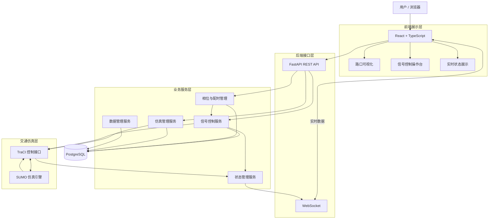
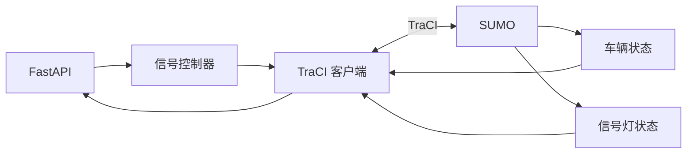
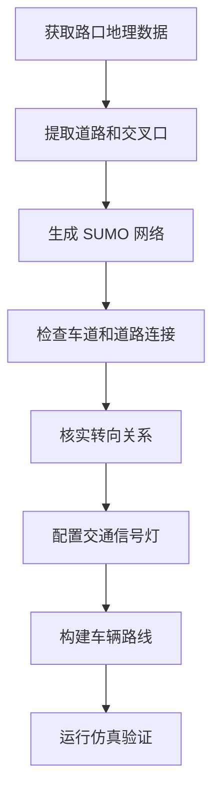
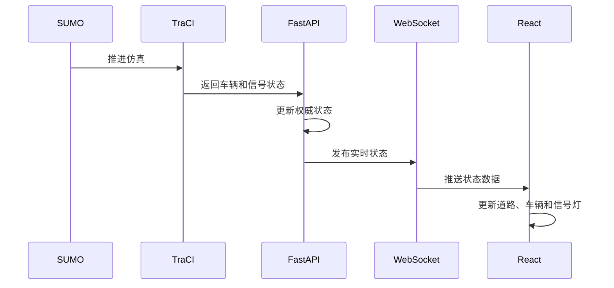
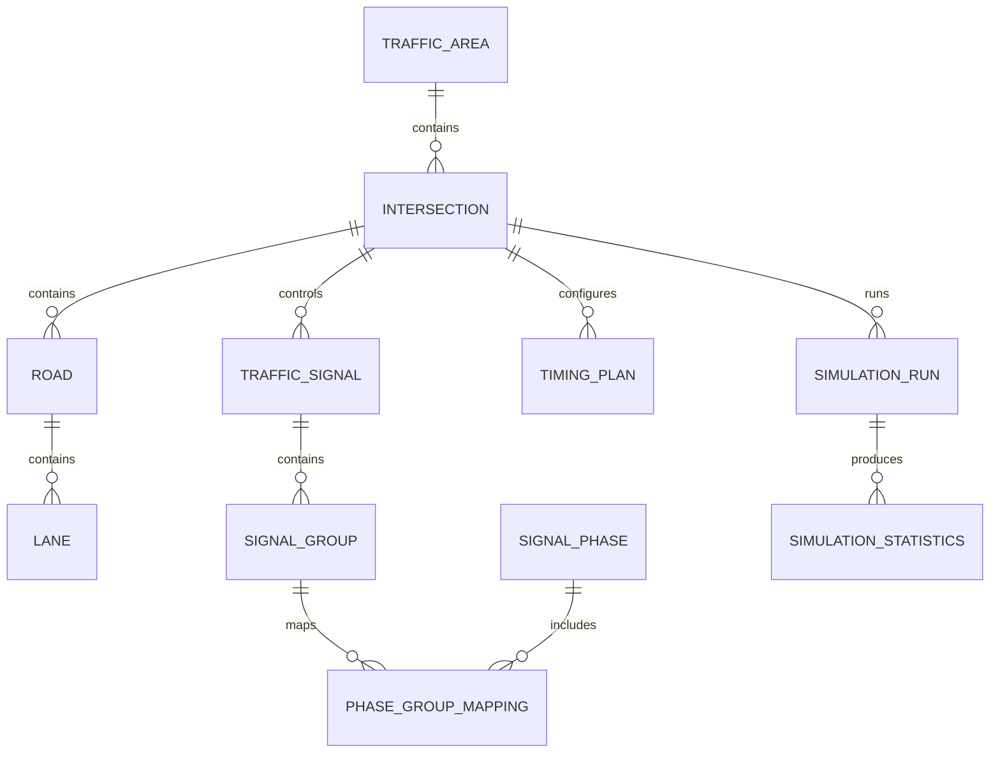
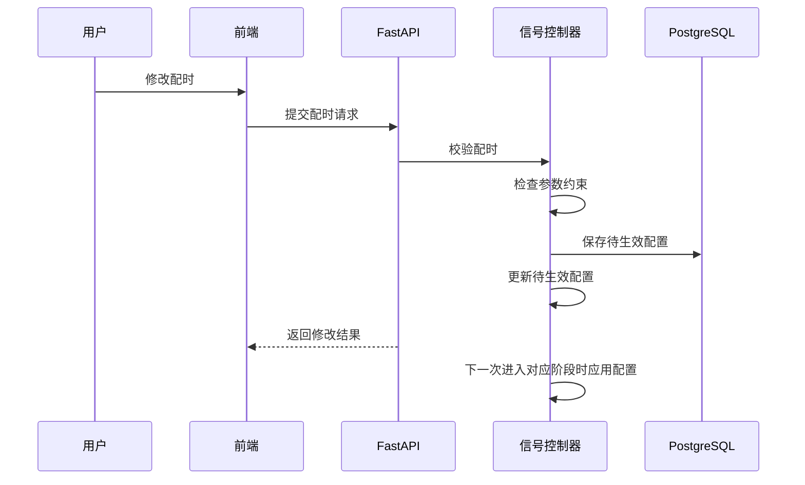
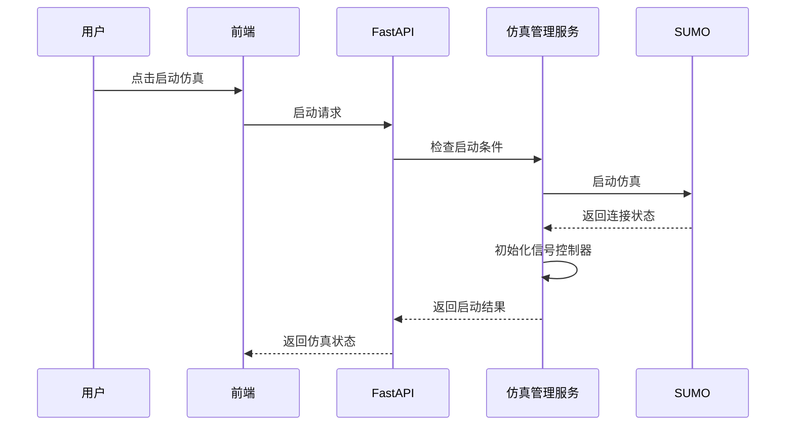
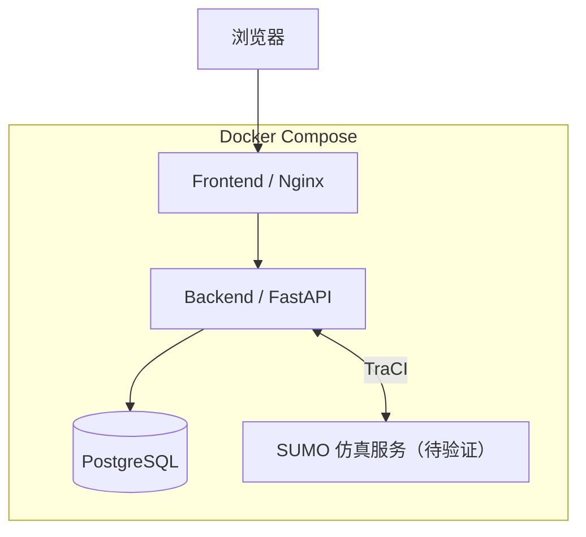

# 系统架构设计

> 文档版本：V1.0
> 创建日期：2026-11-10
> 项目名称：交通信号控制平台
> 文档状态：初稿
> 对应需求文档：`docs/01-requirements.md`

## 1. 架构设计目标

本项目采用前后端分离架构，结合 SUMO 交通仿真引擎，实现单路口交通信号控制、车辆运行仿真、信号状态实时展示和运行数据持久化。

架构设计需要满足以下目标：

1. **信号控制可靠**：信号灯状态、相位切换和倒计时由后端统一管理。
2. **交通仿真真实**：使用 SUMO 模拟车辆运行、车道连接、交通信号灯和车辆通行行为。
3. **实时数据同步**：通过 WebSocket 向浏览器推送车辆位置和信号状态。
4. **配时灵活配置**：支持分别修改南北、东西方向的绿灯和黄灯持续时间，并自动计算对应方向的红灯持续时间。
5. **状态一致性**：后端控制状态与 SUMO 仿真状态保持一致。
6. **模块职责清晰**：前端、后端、信号控制器、仿真引擎和数据库相互解耦。
7. **便于扩展**：为后续增加左转相位、多路口协调控制和自适应信号控制预留接口。

## 2. 总体技术架构

### 2.1 技术选型

| 系统模块  | 技术               | 主要用途           |
| ----- | ---------------- | -------------- |
| 前端框架  | React            | 页面和交互界面        |
| 前端语言  | TypeScript       | 类型安全           |
| 前端构建  | Vite             | 开发和构建          |
| 前端可视化 | SVG / Canvas     | 路口、车道、车辆和信号灯展示 |
| 后端框架  | Python + FastAPI | REST API 和业务服务 |
| 数据校验  | Pydantic         | 请求、响应和配置校验     |
| 实时通信  | WebSocket        | 推送仿真状态         |
| 交通仿真  | SUMO             | 道路网络和车辆运行仿真    |
| 仿真控制  | TraCI            | 控制 SUMO、读取仿真状态 |
| 数据库   | PostgreSQL       | 配时、运行记录和历史数据   |
| 数据访问  | SQLAlchemy       | 数据库 ORM        |
| 数据迁移  | Alembic          | 数据库结构版本管理      |
| 容器部署  | Docker Compose   | 服务部署和管理        |
| 版本管理  | Git + GitHub     | 代码和文档版本管理      |

### 2.2 系统分层

系统划分为五个主要层次：

1. 展示层：浏览器中的交通信号控制操作台。
2. 接口层：FastAPI 提供 REST API 和 WebSocket。
3. 业务层：负责信号控制、配时管理、仿真管理和数据管理。
4. 仿真层：SUMO 和 TraCI。
5. 数据层：PostgreSQL。

### 2.3 系统总体结构



说明：

- REST API 负责配置修改、仿真启动、暂停、恢复和查询。
- WebSocket 负责实时状态推送。
- 信号控制服务负责统一管理信号机状态。
- TraCI 负责将后端控制指令传递给 SUMO。
- SUMO 负责车辆运动和交通规则仿真。
- PostgreSQL 保存需要长期保留的业务数据和仿真记录。

## 3. 前端架构

### 3.1 前端职责

前端主要负责：

1. 展示交通路口的道路和车道。
2. 展示各方向交通信号灯。
3. 展示信号机当前相位和倒计时。
4. 实时展示机动车位置和行驶状态。
5. 提供信号灯配时设置。
6. 提供仿真启动、暂停、恢复和停止操作。
7. 展示仿真运行统计信息。
8. 展示信号灯历史状态和仿真记录。

前端不直接控制 SUMO，也不负责计算信号灯下一次切换时间。

### 3.2 前端组件划分

建议采用以下组件结构：

```
frontend/
└── src/
    ├── api/
    │   ├── http.ts
    │   ├── signal.ts
    │   ├── simulation.ts
    │   └── intersection.ts
    │
    ├── components/
    │   ├── intersection/
    │   │   ├── IntersectionView.tsx
    │   │   ├── Road.tsx
    │   │   ├── Lane.tsx
    │   │   ├── Vehicle.tsx
    │   │   └── TrafficLight.tsx
    │   │
    │   ├── signal/
    │   │   ├── SignalPanel.tsx
    │   │   ├── PhaseDisplay.tsx
    │   │   └── TimingConfig.tsx
    │   │
    │   └── simulation/
    │       ├── SimulationToolbar.tsx
    │       └── SimulationStatus.tsx
    │
    ├── hooks/
    │   ├── useWebSocket.ts
    │   └── useSimulation.ts
    │
    ├── types/
    │   ├── signal.ts
    │   ├── vehicle.ts
    │   └── simulation.ts
    │
    ├── pages/
    │   └── Dashboard.tsx
    │
    └── App.tsx
```

以上为建议目录结构，实际开发时根据模块实现情况逐步建立，不要求一次性创建所有文件。

### 3.3 路口可视化

路口可视化优先采用 SVG。

原因：

- 道路和车道具有明确的几何形状。
- 信号灯需要精确定位。
- 车辆需要根据仿真坐标移动。
- SVG 元素便于实现颜色变化和动画。
- 后续可以根据 SUMO 网络数据生成可视化元素。

前端坐标与 SUMO 坐标之间需要建立统一的转换关系。

车辆位置以 SUMO 返回的位置为准，前端只负责坐标转换和显示。

## 4. 后端架构

### 4.1 后端职责

后端是整个系统的业务控制中心。

主要职责：

1. 接收前端控制请求。
2. 校验信号灯配时参数。
3. 管理信号机运行状态。
4. 管理信号相位切换。
5. 控制 SUMO 仿真。
6. 读取车辆和信号灯状态。
7. 推送实时仿真数据。
8. 保存仿真运行记录。
9. 提供历史数据查询接口。

### 4.2 后端模块划分

```
backend/
├── app/
│   ├── api/
│   │   ├── routes/
│   │   │   ├── signal.py
│   │   │   ├── simulation.py
│   │   │   └── intersection.py
│   │   │
│   │   └── websocket.py
│   │
│   ├── controllers/
│   │   └── signal_controller.py
│   │
│   ├── core/
│   │   ├── config.py
│   │   ├── exceptions.py
│   │   └── logging.py
│   │
│   ├── models/
│   │   ├── signal.py
│   │   ├── simulation.py
│   │   └── vehicle.py
│   │
│   ├── repositories/
│   │   ├── signal_repository.py
│   │   └── simulation_repository.py
│   │
│   ├── services/
│   │   ├── signal_service.py
│   │   ├── timing_service.py
│   │   ├── simulation_service.py
│   │   └── state_service.py
│   │
│   └── simulation/
│       ├── traci_client.py
│       ├── simulation_runner.py
│       └── vehicle_collector.py
│
└── tests/
```

模块职责：

| 模块           | 主要职责            |
| ------------ | --------------- |
| api          | 接收请求和返回响应       |
| controllers  | 实现信号控制状态机       |
| core         | 配置、异常和日志        |
| models       | 数据结构和业务模型       |
| repositories | 数据库读写           |
| services     | 业务逻辑            |
| simulation   | SUMO 和 TraCI 集成 |
| tests        | 自动化测试           |

模块之间通过明确的接口调用，避免直接访问其他模块的内部状态。

## 5. 交通信号控制架构

### 5.1 信号控制基本原则

信号控制器由后端统一维护。

以下信息由后端作为权威状态保存：

- 当前信号阶段。
- 当前相位。
- 当前阶段开始时间。
- 当前阶段计划结束时间。
- 当前剩余时间。
- 当前信号灯颜色。
- 下一阶段。
- 当前生效的配时参数。

SUMO 中的交通信号状态必须与后端信号控制器保持一致。

前端只接收后端推送的数据，不自行维护另一套信号切换逻辑。

### 5.2 第一版信号相位

第一版采用两个基本通行方向：

| 相位   | 南北方向 | 东西方向 |
| ---- | ---- | ---- |
| 相位 A | 允许通行 | 禁止通行 |
| 相位 B | 禁止通行 | 允许通行 |

需要注意：

这只是第一版的基本相位划分，不代表同一方向的所有车道都可以同时放行。

在正式配置 SUMO 信号灯之前，必须根据实际路口道路、车道、转向连接和冲突关系，确定信号组。

左转、直行、右转应分别分析。

如果某些转向之间存在冲突，不允许将它们配置为同时放行。

后续可增加独立左转相位，扩展为多相位控制。

###

### 5.3 信号阶段状态机

第一版采用统一的信号机控制器管理整个路口，不允许南北、东西两个基本相位各自独立计时和切换。

信号机需要同时维护：

- 当前运行相位。

- 当前相位的运行阶段。

- 各信号组的灯色。

- 当前阶段开始时间。

- 当前阶段计划结束时间。

- 当前阶段剩余时间。

- 下一运行相位。

#### 5.3.1 基本相位定义

第一版定义两个基本相位：

| 相位        | 南北信号组 | 东西信号组 |
| --------- | ----- | ----- |
| 相位 A：南北通行 | 绿灯    | 红灯    |
| 相位 B：东西通行 | 红灯    | 绿灯    |

上述定义是基本控制方案，正式配置前必须根据实际车道连接和转向冲突关系确定信号组。

同一方向内的左转、直行、右转不默认具有同时放行条件。存在冲突的交通流必须通过独立信号组或独立相位控制。

#### 5.3.2 相位运行顺序

第一版采用以下交替顺序：

1. 南北方向绿灯，东西方向红灯。

2. 南北方向绿灯结束，进入南北方向黄灯，东西方向继续保持红灯。

3. 南北方向黄灯结束，南北方向切换红灯。

4. 东西方向红灯结束，东西方向切换绿灯。

5. 东西方向绿灯结束，进入东西方向黄灯，南北方向继续保持红灯。

6. 东西方向黄灯结束，东西方向切换红灯。

7. 南北方向红灯结束，南北方向切换绿灯。

8. 循环执行。

两个基本相位之间必须保持互斥，任何时刻不得同时向冲突方向授予通行权。

#### 5.3.3 双相位协调状态机

```
stateDiagram-v2
    [*] --> NS_GREEN

    NS_GREEN --> NS_YELLOW: 南北绿灯结束
    NS_YELLOW --> EW_GREEN: 南北黄灯结束，东西红灯结束

    EW_GREEN --> EW_YELLOW: 东西绿灯结束
    EW_YELLOW --> NS_GREEN: 东西黄灯结束，南北红灯结束
```

说明：

- `NS_GREEN`：南北绿灯、东西红灯。

- `NS_YELLOW`：南北黄灯、东西红灯。

- `EW_GREEN`：南北红灯、东西绿灯。

- `EW_YELLOW`：南北红灯、东西黄灯。

该状态机描述的是第一版两个基本相位的协调控制流程。

实际 SUMO 信号状态必须根据受控连接关系生成，不能直接假设一个方向只对应一个信号灯字符。

#### 5.3.4 信号阶段与信号组的关系

信号机统一管理整个路口的运行阶段，各信号组根据当前阶段获得对应灯色。

| 运行阶段      | 南北信号组 | 东西信号组 |
| --------- | ----- | ----- |
| NS_GREEN  | 绿灯    | 红灯    |
| NS_YELLOW | 黄灯    | 红灯    |
| EW_GREEN  | 红灯    | 绿灯    |
| EW_YELLOW | 红灯    | 黄灯    |

以上为基本信号组的示意映射。最终映射必须根据实际车道、转向和冲突关系校验。

#### 5.3.5 阶段切换安全约束

1. 两个冲突方向不得同时显示绿灯。

2. 南北绿灯结束后必须经过南北黄灯，才能进入东西绿灯。

3. 东西绿灯结束后必须经过东西黄灯，才能进入南北绿灯。

4. 黄灯结束后，对应方向必须进入红灯。

5. 对向方向的红灯持续时间必须覆盖另一方向的绿灯和黄灯阶段。

6. 配时修改不能直接中断正在执行的信号阶段。

7. 后端状态机和 SUMO 实际信号状态必须保持一致。

上述方案不额外增加全红阶段，因为当前需求定义为黄灯结束后直接切换到下一相位。如果后续道路冲突分析或安全验证要求设置全红清空时间，应通过正式的设计变更增加该阶段。

###

### 5.6 信号控制安全

信号控制器必须保证：

- 冲突方向不会同时获得通行权。
- 相位切换顺序符合配置。
- 红灯、绿灯、黄灯时长符合约束。
- 信号状态与 SUMO 实际信号状态一致。
- 仿真暂停时信号状态不继续推进。
- 仿真恢复时从正确的阶段继续运行。
- 配时修改不能造成当前阶段异常跳变。

所有信号组必须根据 SUMO 的 controlled links 和信号状态字符串进行映射，不能简单假设一个信号灯对应一个字符。

## 6. SUMO 仿真架构

### 6.1 SUMO 的职责

SUMO 是交通运行仿真引擎，负责：

1. 道路网络加载。
2. 车道和连接关系管理。
3. 车辆生成。
4. 车辆路线规划。
5. 车辆运动和跟驰。
6. 车辆变道。
7. 交通信号灯对车辆通行行为的影响。
8. 车辆位置和运行状态输出。

后端通过 TraCI 控制 SUMO。

### 6.2 SUMO 与后端的关系



### 6.3 仿真运行流程

1. 后端检查仿真配置。
2. 后端启动 SUMO 仿真进程。
3. TraCI 建立与 SUMO 的连接。
4. 后端读取仿真初始化状态。
5. 后端信号控制器初始化相位和配时。
6. 后端向 SUMO 设置初始信号状态。
7. SUMO 开始推进仿真时间。
8. 后端读取车辆位置和信号灯状态。
9. 后端更新权威状态。
10. WebSocket 推送实时数据。
11. 仿真结束后保存运行结果。

### 6.4 仿真时间管理

仿真系统采用 SUMO 仿真时间作为运行时间基准。

后端应明确区分：

- 系统真实时间。
- SUMO 仿真时间。
- 信号阶段开始时间。
- 信号阶段计划结束时间。

信号倒计时以仿真时间为准，不直接依赖浏览器本地时钟。

仿真暂停期间，仿真时间不应继续推进。

仿真恢复后，信号阶段剩余时间应与暂停时保持一致。

### 6.5 SUMO 部署方式待验证事项

SUMO 与 FastAPI 的部署位置需要在后续技术验证阶段确定。

主要考虑两种方案：

**方案 A：SUMO 与后端部署在同一个容器**

优点：

- TraCI 本地连接简单。
- 部署结构相对简单。
- 不需要额外管理远程仿真连接。

缺点：

- 仿真进程与 API 服务耦合。
- 进程管理和故障恢复需要额外设计。
- SUMO GUI 不适合直接在普通 Linux 容器中展示。

**方案 B：SUMO 独立部署为仿真服务**

优点：

- 仿真进程与 API 服务解耦。
- 更便于后续扩展多个仿真实例。
- 可以独立管理仿真生命周期。

缺点：

- 需要管理 TraCI 远程连接。
- 需要设计服务间通信和异常恢复。
- 部署配置更复杂。

**当前设计决定：暂不锁定最终方案。**

需要先验证 Windows 开发环境、Docker Linux 容器和 SUMO/TraCI 的实际运行方式，再根据验证结果确定部署方案。

不能假定宿主机 Windows 安装的 SUMO 可以直接在 Linux Docker 容器内导入和使用 TraCI。

## 7. 道路网络与仿真场景

### 7.1 仿真地点

第一版仿真地点：

天津市河东区新开路与华龙道交叉口。

### 7.2 道路网络数据来源

优先调查 OpenStreetMap（OSM）道路数据，结合 SUMO 的 `netconvert` 工具生成仿真网络。

基本流程：



### 7.3 道路模型校验

OSM 数据不一定包含完整、准确的车道转向和信号控制信息。

因此，生成 SUMO 网络后必须检查：

- 道路数量和连接关系。
- 道路方向。
- 车道数量。
- 车道宽度。
- 车道转向属性。
- 路口内部连接。
- 左转、直行和右转关系。
- 信号灯控制连接。
- 不同通行方向之间的冲突关系。

必要时使用 SUMO 网络编辑工具进行人工校正。

### 7.4 数据可信度标记

道路模型中的数据需要区分：

| 数据类型 | 说明               |
| ---- | ---------------- |
| 来源数据 | 从 OSM 或其他可靠资料获取  |
| 校正数据 | 根据道路资料和网络检查修正    |
| 假设数据 | 暂时缺少可靠来源时使用的仿真参数 |

不得将未经核实的假设数据描述为真实道路测绘数据。

## 8. 实时通信架构

### 8.1 WebSocket 职责

WebSocket 用于向前端推送仿真运行状态。

主要推送内容：

- 仿真时间。
- 仿真运行状态。
- 当前信号相位。
- 各信号组灯色。
- 各信号组剩余时间。
- 车辆位置。
- 车辆速度。
- 车辆运行状态。
- 必要的仿真统计数据。

### 8.2 数据流



### 8.3 实时消息结构

第一版建议使用统一的消息结构：

```json
{
  "type": "simulation_update",
  "simulation_time": 120.0,
  "simulation_status": "running",
  "signal": {
    "phase_id": "phase_ns",
    "phase_name": "南北通行",
    "groups": [
      {
        "group_id": "north_south",
        "state": "G",
        "remaining_time": 8,
        "countdown_visible": true
      },
      {
        "group_id": "east_west",
        "state": "r",
        "remaining_time": 22,
        "countdown_visible": false
      }
    ]
  },
  "vehicles": []
}
```

说明：

- 上述 JSON 为结构示例，不代表最终 API 字段已经定稿。
- `state` 需要与 SUMO 信号状态及业务灯色定义建立明确映射。
- `vehicles` 后续根据实际车辆数据结构补充。
- 前端必须以服务端推送的状态为准。

### 8.4 WebSocket 异常处理

需要考虑：

- 客户端断开连接。
- 客户端重新连接。
- 推送失败。
- 消息处理延迟。
- 重复消息。
- 前端页面刷新。

客户端重新连接后，应通过状态查询接口或 WebSocket 初始化消息获取最新完整状态，不能只依赖后续增量消息。

## 9. 数据库架构

### 9.1 数据库职责

PostgreSQL 用于保存需要持久化的业务数据。

主要包括：

- 交通路口信息。
- 道路和车道信息。
- 交通信号灯信息。
- 信号组和相位配置。
- 配时配置。
- 仿真运行记录。
- 仿真统计结果。
- 必要的信号状态历史。

车辆的高频实时位置优先保留在仿真运行时内存中，通过实时通信推送。

是否长期保存完整车辆轨迹，需要根据数据量和查询需求进一步设计，避免将高频仿真数据无差别写入数据库。

### 9.2 核心实体关系



说明：

以上为概念级实体关系，实际表结构、外键、索引和约束在 `docs/03-database-design.md` 中进一步确定。

### 9.3 数据一致性

- 数据库保存配时配置和历史记录。
- 后端内存保存当前仿真运行状态。
- SUMO 保存实际仿真中的车辆和信号状态。
- 后端负责协调以上状态的一致性。

不能将数据库中的历史状态误认为当前实时状态。

## 10. 控制请求与实时状态流程

### 10.1 修改信号配时



### 10.2 仿真启动



### 10.3 暂停和恢复

暂停时：

1. 前端发送暂停请求。
2. 后端通知仿真管理服务。
3. SUMO 停止推进仿真时间。
4. 后端保存当前信号阶段状态。
5. 前端显示暂停状态。

恢复时：

1. 前端发送恢复请求。
2. 后端检查仿真连接。
3. 恢复 SUMO 仿真推进。
4. 信号控制器继续按照仿真时间运行。
5. WebSocket 恢复实时推送。

## 11. 安全与异常处理

### 11.1 信号控制安全

以下情况必须由后端拒绝或阻止：

- 红灯时长不符合约束。
- 绿灯时长不符合约束。
- 黄灯时长小于或等于 0。
- 相位配置存在冲突。
- 仿真未启动时执行不允许的控制操作。
- 仿真已经停止时继续发送控制命令。
- SUMO 与后端状态出现无法自动恢复的不一致。

### 11.2 仿真异常

需要处理：

- SUMO 启动失败。
- TraCI 连接失败。
- SUMO 进程意外退出。
- 仿真推进异常。
- 车辆数据读取失败。
- 信号灯状态读取失败。
- 数据库连接失败。

发生关键仿真异常时，应停止继续发送不可靠的控制指令，并将系统标记为异常状态。

### 11.3 日志

日志至少记录：

- 仿真启动和停止。
- 信号相位切换。
- 配时修改。
- 信号控制命令。
- TraCI 连接状态。
- WebSocket 连接异常。
- SUMO 异常退出。
- 数据库操作异常。

重要操作应记录发生时间、操作内容、操作结果和关联仿真运行编号。

## 12. 部署架构

### 12.1 计划部署服务

Docker Compose 计划管理以下服务：

| 服务         | 作用                  |
| ---------- | ------------------- |
| frontend   | React 前端和 Nginx     |
| backend    | FastAPI 后端          |
| database   | PostgreSQL          |
| simulation | SUMO 仿真服务，是否独立部署待验证 |

### 12.2 部署关系



### 12.3 部署原则

- 服务使用明确的容器名称。
- 服务之间通过 Docker 网络通信。
- 数据库使用持久化卷。
- 配置通过环境变量或配置文件管理。
- 敏感信息不得直接提交到 Git。
- 提供统一的启动、停止和日志查看命令。
- README 中的启动命令必须经过实际验证。

最终部署方式以实际验证结果为准。

## 13. 开发实施顺序

按照以下顺序实施，避免前端、后端和仿真模块同时大规模开发。

| 阶段   | 工作内容       | 主要验收目标        |
| ---- | ---------- | ------------- |
| 第一阶段 | 项目初始化与规范   | 目录、Git、基础文档   |
| 第二阶段 | SUMO 道路网络  | 路口道路和车道能够正常仿真 |
| 第三阶段 | 信号机状态机     | 红绿黄灯切换和配时规则正确 |
| 第四阶段 | FastAPI 接口 | 可以查询和控制仿真     |
| 第五阶段 | PostgreSQL | 配时和仿真记录持久化    |
| 第六阶段 | React 可视化  | 浏览器展示路口和车辆    |
| 第七阶段 | 信控操作台      | 修改配时、控制仿真     |
| 第八阶段 | 联调与测试      | 控制、仿真、实时展示闭环  |
| 第九阶段 | Docker 部署  | 可重复部署和运行      |

每个阶段完成后先进行验证，再进入下一阶段。

## 14. 第一版范围与后续扩展

### 14.1 第一版必须实现

- 单个十字路口。
- 道路、车道和车辆仿真。
- 两个基本通行相位。
- 红灯、绿灯和黄灯状态切换。
- 红灯结束前 10 秒倒计时。
- 绿灯结束前 8 秒倒计时。
- 默认 3 秒黄灯。
- 红灯和绿灯时长可配置。
- 后端信号控制器。
- SUMO + TraCI 联动。
- FastAPI 接口。
- WebSocket 实时推送。
- React 路口可视化。
- PostgreSQL 数据持久化。
- Docker Compose 部署。

### 14.2 后续扩展

第一版稳定后，再考虑：

- 独立左转相位。
- 多路口协调控制。
- 绿波带。
- 自适应信号控制。
- 基于交通流量的配时优化。
- 历史交通数据分析。
- 多路口运行状态总览。
- 更精细的车辆类型和驾驶行为模拟。

## 15. 架构设计决策记录

| 编号      | 设计事项      | 当前决定                      | 状态            |
| ------- | --------- | ------------------------- | ------------- |
| ADR-001 | 前端框架      | React + TypeScript + Vite | 已确定           |
| ADR-002 | 后端框架      | Python + FastAPI          | 已确定           |
| ADR-003 | 交通仿真引擎    | SUMO                      | 已确定           |
| ADR-004 | 仿真控制接口    | TraCI                     | 已确定           |
| ADR-005 | 实时通信      | WebSocket                 | 已确定           |
| ADR-006 | 数据库       | PostgreSQL                | 已确定           |
| ADR-007 | 第一版信号相位   | 两个基本相位                    | 已确定，需核实实际冲突关系 |
| ADR-008 | 信号状态权威来源  | 后端信号控制器                   | 已确定           |
| ADR-009 | 路口道路数据    | 优先调查 OSM 数据               | 待验证           |
| ADR-010 | SUMO 部署位置 | 同容器或独立容器                  | 待验证           |
| ADR-011 | 前端路口绘制    | 优先 SVG                    | 已确定           |
| ADR-012 | 仿真车辆历史数据  | 高频实时数据不默认全部持久化            | 初步决定          |

## 16. 当前待验证事项

在进入正式业务功能开发前，需要逐步完成以下技术验证：

- 

  Windows 环境下 SUMO 安装与命令行运行。

- 

  Python 环境能够正确导入 TraCI。

- 

  SUMO 能够通过 TraCI 启动和推进仿真。

- 

  验证 Docker 环境下 SUMO 与 TraCI 的部署方案。

- 

  获取新开路与华龙道交叉口道路数据。

- 

  检查 SUMO 网络中的车道连接和转向关系。

- 

  确定实际信号组及冲突矩阵。

- 

  验证信号灯状态字符串与 SUMO controlled links 的映射。

- 

  验证红灯、绿灯、黄灯切换边界。

- 

  验证暂停和恢复期间的仿真时间一致性。

**文档维护原则：**

本文件记录系统整体架构和重要技术决策。后续实现过程中，如果技术方案发生变化，应同步更新本文件及相关设计文档，并在 `docs/decisions/` 中记录重要架构决策。

架构文档中的待验证事项，只有在实际运行和测试通过后才能标记为完成。
